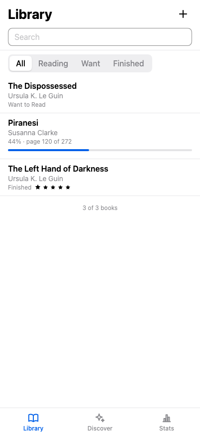
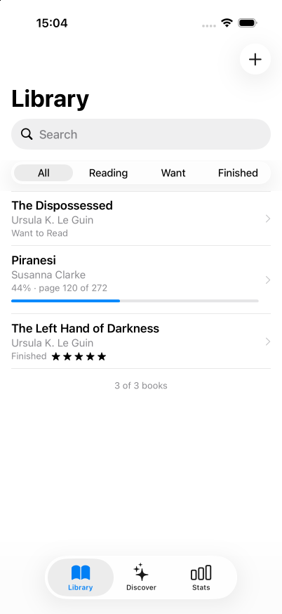

# e2e-exact

Shelf, a reading tracker built with [Exact](https://github.com/expo/exact), tested end to end with [e2e](https://www.npmjs.com/package/e2e). Exact compiles one `app.contract` to a web page and to a native UIKit app, and one e2e test file drives both: Chromium on the web, the iOS Simulator on iOS.

<p>
  
  
</p>

## How it works

The app is Exact's `apps/shelf`, minus its camera, barcode, NFC, widget and Siri features:

- **`app.contract`** is the whole UI. It says what each thing is and leaves the look to the platform. On iOS a `header` becomes the navigation bar, a `tablist` the tab bar or a segmented control, the add route a sheet, and the remove `dialog` the system alert. On the web it's a page.
- **`app.ts`** answers the data: the library is one JSON file in the app's storage, seeded with three books. Discover reads [Open Library](https://openlibrary.org/developers/api).
- **`tests/shelf.e2e.ts`** is the one test file for both platforms.

Every `testId` in the contract becomes `data-testid` on the web and the `accessibilityIdentifier` on iOS. So `screen.getByTestId('add-book')` finds the same button on both.

## Getting started

You need [Bun](https://bun.sh) 1.4.2+, [Rust](https://rustup.rs), Node 22.22.3+ or 24.8+ (for e2e), and Xcode with an iOS simulator. Exact has no npm package: clone it and point this app at it with `EXACT2`:

```bash
git clone https://github.com/expo/exact ~/exact
cd ~/exact && bun install --frozen-lockfile && cd -
export EXACT2=~/exact

npm install
npm run web       # the dev loop in the browser
npm run ios       # builds, installs and opens the app on a simulator
```

The first iOS build takes a few minutes. If it says the Hermes bundle is missing, run the `cargo run … hermes-lean-sys-installer` command it prints, then build again. Later builds take seconds.

## End-to-end tests

`tests/shelf.e2e.ts` runs unchanged on both targets:

| Test | Checks |
| --- | --- |
| Opens with the seed books, newest first | The count and each row's status |
| Search and the filter narrow the list | Typing in the search field, then the segmented control |
| The add sheet checks the title, then saves a book that survives a restart | The validation error, the new row, and the library after `app.restart()` |
| A book moves forward, finishes and takes a rating | +10 pages, Finished, four stars, and the row's new label |
| Removing a book asks first | The web dialog and the iOS system alert, by their Remove button |
| Adds a book it is told about (agent) | `agent.act` fills the sheet; the checks after it are exact |
| Raises the yearly goal on the Stats tab (agent) | `agent.act` on another tab |

Each test starts from the seed library: `app.clearState()` clears the browser's storage on the web and the app's data on the simulator.

The agent tests need a [Vercel AI Gateway](https://vercel.com/docs/ai-gateway) key: copy `.env.example` to `.env.local` and set `AI_GATEWAY_API_KEY`. Without it they skip. With the iOS app installed (`npm run ios`), run:

```bash
npx e2e run --target web
npx e2e run --target ios
```

Without `--target`, both run, on two workers. The web target serves the release build on port 8765 (`npm run preview`), or reuses one already running. With more than one simulator booted, set `IOS_DEVICE`.

### Replay cache

The replay cache in `.e2e/cache/` is committed. It holds the recorded actions of each agent step, one entry per test and target. So the agent tests replay without model calls, and fall back to the agent only when the screen no longer matches. Add `--no-cache` to make fresh model calls:

```bash
npx e2e run --no-cache
```

When the app changes and the agent has to take a step over, the run records it again: commit the changed entries with the change that caused them. `npx e2e cache ls` lists the entries. See [Caching](https://e2e.com/docs/cache).

### Where iOS reads differently

A test written against the web can fail on iOS for reasons a person using VoiceOver would recognise. The tests here are written so both pass:

- **A list row is one element.** UIKit reads a row as a single item ("Piranesi, Susanna Clarke, 44% · page 120 of 272"), so a `testId` inside a row isn't there on iOS. The tests check the row: `getByTestId('book-seed-2')` with `toContainText`, or `getByRole('link', { name: /Wolf Hall/ })`.
- **A form field's `testId` is on its row too.** On iOS, Exact puts it on the field's wrapper as well, so `getByTestId('add-title')` matches twice. The `field()` helper takes the last match, the field itself.
- **A grouped list's footer text has no `testId` on iOS.** The tests find "Enter a title." and "48% read" by their text.
- **Buttons go by role and name.** `getByRole('button', { name: 'Forward 10 pages' })` is the same on both, and it's what a screen reader announces.

## Scripts

| Command | Description |
| --- | --- |
| `npm run web` | Exact's dev loop in the browser |
| `npm run ios` | Build, install and open the app on an iOS simulator |
| `npm run preview` | Build the release web app and serve it on port 8765 |
| `npm run test:e2e` | Run the e2e tests on web and iOS |
| `npm run test:e2e:web` | Run the e2e tests on the web |
| `npm run test:e2e:ios` | Run the e2e tests on iOS |

## About e2e

<a href="https://e2e.com">
  <picture>
    <source media="(prefers-color-scheme: dark)" srcset="docs/e2e-logo-white.png">
    
  </picture>
</a>

[e2e](https://e2e.com) is an open source end-to-end testing framework for web and mobile apps, made by [TesterArmy](https://tester.army). Describe a goal in natural language and an agent drives the app to reach it. Check the result with locators and assertions in the same test. A verified agent step is recorded, and later runs replay it with no model calls until the app changes.

- [Docs](https://e2e.com/docs)
- [More examples](https://e2e.com/examples)
- [GitHub](https://github.com/tester-army/e2e)
